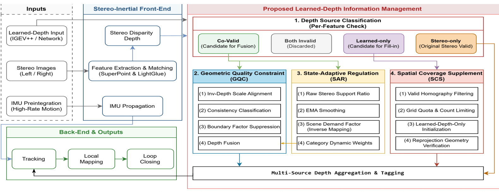
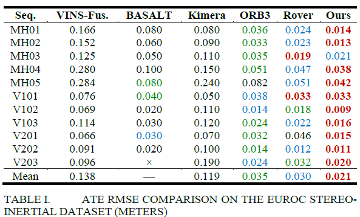
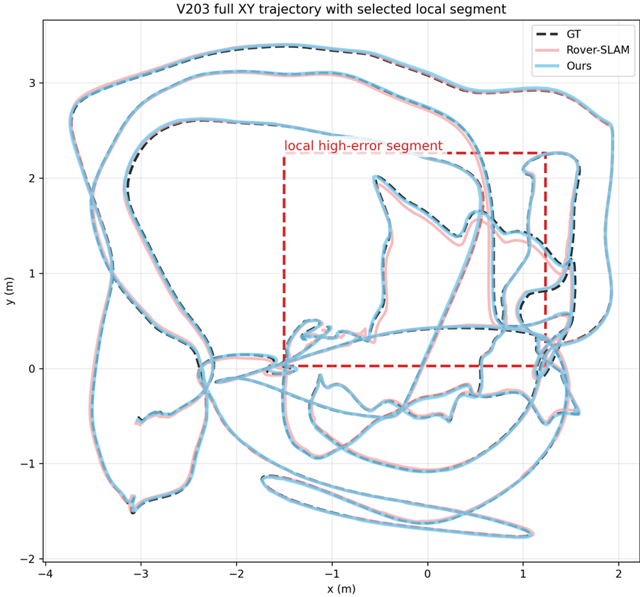
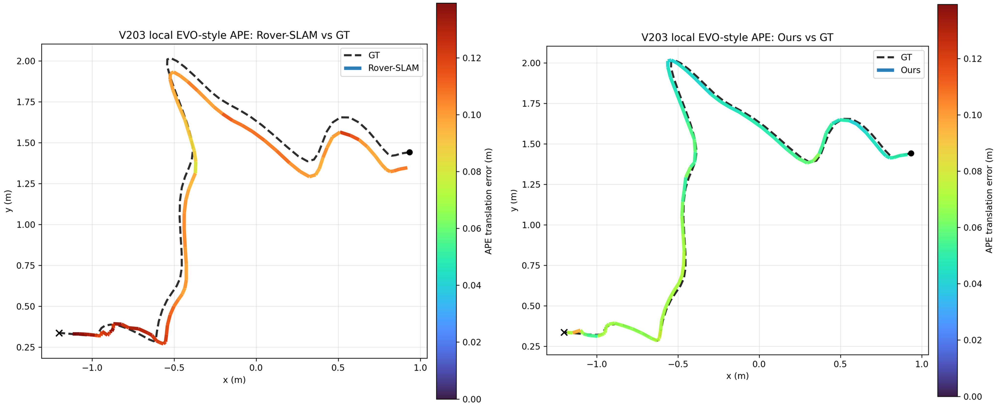
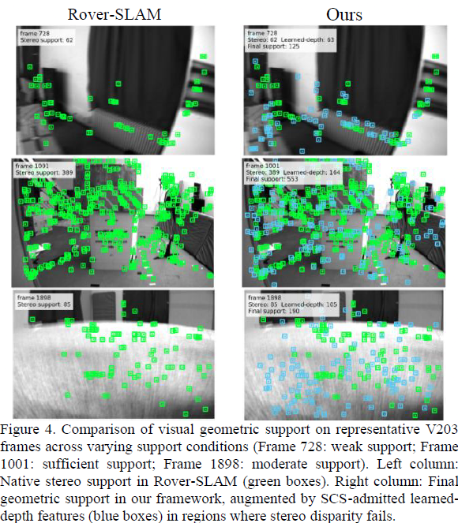

# Hybrid Stereo-Inertial SLAM Based on Adaptive Learned-Depth Fusion

[](LICENSE)
[](docker/Dockerfile)
[](docker/Dockerfile)

**Chih-Han Ma, Jun-Sheng Huang, Chih-Ming Hsu**

*Companion code release for the manuscript prepared for IEEE journal submission.*

> **Double-Blind Check**: If the target IEEE venue enforces double-blind peer review, anonymize the author list, GitHub handle, and BibTeX entry before making the repository public.

---

## Overview

Sparse stereo matching in deep feature-based stereo-inertial SLAM (such as [Rover-SLAM](https://github.com/zzzzxxxx111/Rover-SLAM)) often suffers sharp drops in geometric support under rapid rotation, motion blur, or low-texture surfaces (e.g., EuRoC `V203`). Rather than blindly injecting dense learned predictions into bundle adjustment, this project integrates learned stereo depth ([IGEV++](https://github.com/gangweiX/IGEV-plusplus)) at the **front-end depth assignment stage** through three coupled modules—**Geometric Quality Constraint (GQC)**, **State-Adaptive Regulation (SAR)**, and **Spatial Coverage Supplement (SCS)**—while leaving the back-end visual-inertial bundle adjustment (`VIBA`) and loop closing unmodified.



---

## Scope of This Release

To keep this companion repository lightweight and easy to audit during peer review, it contains our **core hybrid-depth front-end modules, IGEV++ metric depth inference pipeline, sensor configurations, evaluation utilities, and reproducible Docker setup**:

* **Front-End Hybrid Depth Core (`hybrid_depth/`)**: Pure-C++ `.npy` metric depth loader ([`RoverIgevDepth`](hybrid_depth/src/RoverIgevDepth.cc)) and `Frame`-level `GQC`, `SAR`, and `SCS` implementation ([`Frame.cc`](hybrid_depth/src/Frame.cc)).
* **AI Metric Depth Inference (`depth_inference/`)**: Offline `cam0`-aligned metric depth generator using IGEV++ `eth3d.pth` ([`euroc_igevpp_eth3d_depth.py`](depth_inference/euroc_igevpp_eth3d_depth.py)).
* **Configs & Entrypoints (`configs/`, `examples/`)**: EuRoC candidate-1800 and ZED2i + GX5 IMU settings along with deterministic/ZED2i C++ entrypoints.
* **Docker & Evaluation (`docker/`, `scripts/`)**: Reproducible CUDA 11.8 + ROS Noetic + OpenCV 3.4.13 + ONNX Runtime GPU environment, `SE(3)` / `Sim(3)` EuRoC ATE evaluator ([`evaluate_euroc_ate.py`](scripts/evaluate_euroc_ate.py)), and per-frame CSV summary analyzer ([`analyze_evidence_runs.py`](scripts/analyze_evidence_runs.py)).

*Upstream third-party libraries (`DBoW3`, `g2o`, `Sophus`), pretrained model checkpoints (`eth3d.pth`, `superpoint.onnx`, `lightglue_sim.onnx`, DBoW vocabulary), and raw datasets are excluded from Git and integrated via [`hybrid_depth/INTEGRATION.md`](hybrid_depth/INTEGRATION.md).*

---

## Core Modules

Immediately after native sparse stereo matching (`ComputeStereoMatches()`), [`Frame::ApplyIgevDepthIfAvailable()`](hybrid_depth/src/Frame.cc) classifies keypoints against the learned metric depth map and executes:

| Module | Role | Key Mechanisms |
| :--- | :--- | :--- |
| **GQC** (*Geometric Quality Constraint*) | Reliability verification & inverse-depth fusion on co-valid features | 1) Per-frame 2.5-MAD scale alignment (`G1`, clamped to $[0.90, 1.10]$ with 0.5 damping)<br>2) Relative consistency tiering (`High` $\le 25\%$, `Mid` $25\%\text{--}50\%$, `Conflict` $>50\%$ fallback to native stereo)<br>3) 4-neighbor depth boundary suppression ($>35\%$ jump)<br>4) Inverse-depth ($1/z$) weighted fusion |
| **SAR** (*State-Adaptive Regulation*) | Frame-level adaptive fusion weight scheduling | Computes raw stereo support ratio $S_t$, applies EMA smoothing ($\alpha = 0.20$), maps to continuous scene demand $D \in [0, 1]$, and linearly interpolates High/Mid/Edge fusion weights across three anchors (`light`, `balanced`, `robust`). |
| **SCS** (*Spatial Coverage Supplement*) | Bounded feature depth completion in stereo-failed regions | Injects learned-depth-only (`IGEV_ONLY`) support inside an $8 \times 6$ spatial grid with adaptive per-cell quotas ($4\text{--}6$ pts/cell), feature response gating ($\ge 0.15$), and **monocular-residual safety** (`ROVER_IGEV_ONLY_MONO_RESIDUAL=1`, `mvuRight = -1`) so supplemented points do not fabricate right-camera stereo disparity. |

---

## Experimental Results

### Quantitative Accuracy on the EuRoC Stereo-Inertial Dataset

**Table I. ATE RMSE Comparison on the EuRoC Stereo-Inertial Dataset (Meters)**



<details>
<summary>View Plain-Text Markdown Table (MH01–V203)</summary>

| Seq. | VINS-Fusion | BASALT | Kimera | ORB-SLAM3 | Rover-SLAM | **Ours** |
| :--- | :---: | :---: | :---: | :---: | :---: | :---: |
| `MH01` | 0.166 | 0.080 | 0.080 | 0.036 | 0.024 | **0.014** |
| `MH02` | 0.152 | 0.060 | 0.090 | 0.033 | 0.023 | **0.013** |
| `MH03` | 0.125 | 0.050 | 0.110 | 0.035 | **0.019** | 0.021 |
| `MH04` | 0.280 | 0.100 | 0.150 | 0.051 | 0.047 | **0.038** |
| `MH05` | 0.284 | 0.080 | 0.240 | 0.082 | 0.051 | **0.042** |
| `V101` | 0.076 | 0.040 | 0.050 | 0.038 | **0.033** | **0.033** |
| `V102` | 0.069 | 0.020 | 0.110 | 0.014 | 0.018 | **0.009** |
| `V103` | 0.114 | 0.030 | 0.120 | 0.024 | 0.022 | **0.016** |
| `V201` | 0.066 | 0.030 | 0.070 | 0.032 | 0.046 | **0.015** |
| `V202` | 0.091 | 0.020 | 0.100 | 0.014 | 0.012 | **0.011** |
| `V203` | 0.096 | × | 0.190 | 0.024 | 0.032 | **0.020** |
| **Mean** | 0.138 | — | 0.119 | 0.035 | 0.030 | **0.021** |

</details>

*On our archived 3-run `V203` verification logs (`1921` frames, `1805` matched poses), per-frame front-end support averaged `145.0` GQC-High fused pts (`27.3%`), `20.5` GQC-Mid fused pts (`3.5%`), `31.2` Conflict native-stereo fallbacks (`5.3%`), and `56.9` SCS-completed pts (`10.5%`), achieving `0.0203 m` best `Sim(3)` RMSE (`0.0207 m` strict `SE(3)`).*

### Qualitative Comparisons on EuRoC `V203`

**Full Trajectory & Local High-Error Segment (`V203`)**



**Localized APE Translation Error (`Rover-SLAM` vs. `Ours`)**



**Geometric Support Expansion Across Challenging Conditions (`V203` Frames 728, 1001, 1898)**



---

## Quick Start

### 1. Build the Docker Environment

```bash
cd docker
docker compose build
docker compose up -d
docker compose exec roverslam-hybrid-depth zsh
```

### 2. Assemble Upstream Code & Checkpoints

Follow [`hybrid_depth/INTEGRATION.md`](hybrid_depth/INTEGRATION.md) to integrate `hybrid_depth/`, `examples/`, and `configs/` into upstream `Rover-SLAM` (`452a37a`) and `IGEVpp` (`099dec9`), and provide the pretrained weights:

* **IGEV++ ETH3D**: `eth3d.pth` (SHA-256: `4595ac1c164b92e9b749907f09248c05abb6485e3121924b2d0bcd3eb3572e97`)
* **Rover-SLAM assets**: `superpoint.onnx`, `lightglue_sim.onnx`, `voc_binary_tartan_8u_6.yml.gz`

### 3. Generate Offline Metric Depth Maps (EuRoC)

```bash
python3 depth_inference/euroc_igevpp_eth3d_depth.py \
  --sequence-dir /datasets/EuRoC/V203 \
  --checkpoint /workspace/igev_ws/IGEVpp/pretrained_models/igev_plusplus/eth3d.pth \
  --output-dir /datasets/EuRoC/V203/depth_igevpp_eth3d
```

### 4. Run Hybrid-Depth Stereo-Inertial SLAM

```bash
export ROVER_IGEV_DEPTH_DIR=/datasets/EuRoC/V203/depth_igevpp_eth3d
export ROVER_IGEV_INVDEPTH_CALIB=1
export ROVER_IGEV_EDGE_AWARE=1
export ROVER_IGEV_ALLOW_IGEV_ONLY=1
export ROVER_IGEV_ONLY_MONO_RESIDUAL=1
export ROVER_IGEV_GRID_SELECT=1
export ROVER_IGEV_CONTINUOUS_FRAME_WEIGHT=1

./Examples/Stereo-Inertial/stereo_inertial_euroc \
  Vocabulary/voc_binary_tartan_8u_6.yml.gz \
  Examples/Stereo-Inertial/EuRoC_D4_candidate1800.yaml \
  /datasets/EuRoC/V203 \
  Examples/Stereo-Inertial/EuRoC_TimeStamps/V203.txt \
  v203_hybrid_auto \
  --no-viewer --offline-blocking
```

### 5. Evaluate Trajectory Accuracy

Evaluate against official EuRoC MAV ground truth using strict `SE(3)` alignment (default) or `Sim(3)` (`--align-scale`):

```bash
python3 scripts/evaluate_euroc_ate.py \
  --gt /datasets/EuRoC/V203/mav0/state_groundtruth_estimate0/data.csv \
  --traj f_v203_hybrid_auto.txt \
  --out-dir ./eval_out
```

---

## Runtime Ablation Flags

All modules can be controlled via environment variables verified in [`Frame.cc`](hybrid_depth/src/Frame.cc):

| Configuration | Environment Variable Overrides |
| :--- | :--- |
| **Full Method (`GQC + SAR + SCS`)** | `ROVER_IGEV_CONTINUOUS_FRAME_WEIGHT=1` `ROVER_IGEV_INVDEPTH_CALIB=1` `ROVER_IGEV_EDGE_AWARE=1` `ROVER_IGEV_ALLOW_IGEV_ONLY=1` `ROVER_IGEV_GRID_SELECT=1` |
| **Without SAR** (Fixed weights) | `ROVER_IGEV_CONTINUOUS_FRAME_WEIGHT=0` |
| **Without GQC Scale Alignment (`G1`)** | `ROVER_IGEV_INVDEPTH_CALIB=0` |
| **Without GQC Boundary Suppression** | `ROVER_IGEV_EDGE_AWARE=0` |
| **Without SCS Completion (`IGEV_ONLY`)** | `ROVER_IGEV_ALLOW_IGEV_ONLY=0` |
| **Without `8x6` Grid Quota Selection** | `ROVER_IGEV_GRID_SELECT=0` |
| **Native Stereo Baseline** | Unset `ROVER_IGEV_DEPTH_DIR` |

---

## License & Acknowledgements

* This derivative SLAM codebase is distributed under the **GNU General Public License v3.0 (GPL-3.0)** — see [`LICENSE`](LICENSE) and [`THIRD_PARTY_NOTICES.md`](THIRD_PARTY_NOTICES.md).
* Built upon [ORB-SLAM3](https://github.com/UZ-SLAMLab/ORB_SLAM3), [Rover-SLAM](https://github.com/zzzzxxxx111/Rover-SLAM), and [IGEV++](https://github.com/gangweiX/IGEV-plusplus).

### Citation

```bibtex
@article{ma2026hybriddepth,
  title   = {Hybrid Stereo-Inertial SLAM Based on Adaptive Learned-Depth Fusion},
  author  = {Ma, Chih-Han and Huang, Jun-Sheng and Hsu, Chih-Ming},
  journal = {Manuscript under preparation for IEEE journal submission},
  year    = {2026}
}
```
